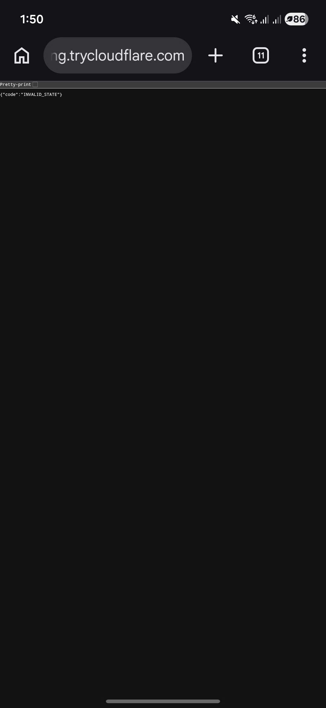
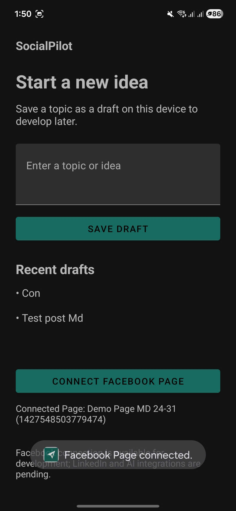

# SP-010 — backend restart during pending OAuth, 12/11/2026

## Result and provenance

**REAL PASS — owner-executed pending-session rejection and fresh-session recovery.** Minh confirmed “đã thành công, các bước đều đúng theo những gì bạn đề cập” after the instructed backend-restart test and supplied the two unchanged phone screenshots below.

The browser screenshot shows `{"code":"INVALID_STATE"}`. The SocialPilot screenshot shows the new connection toast “Facebook Page connected.” and Connected Page: Demo Page MD 24-31 (`1427548503779474`). The restart timing, unchanged running tunnel, order of operations and creation of a fresh session are supported by the owner's confirmation; the screenshots alone do not capture those actions or an HTTP status code.

## Environment

- Date recorded: 12/11/2026, Asia/Bangkok. No exact execution timestamp is inferred from the phone clock.
- Owner/tester: TV1 — Ngô Gia Minh.
- Physical device: Samsung SM-G990E, Android 16 / API 36, from the established device setup; serial omitted.
- Tested source: `2004a97076a0a81c84675508270f50348e6baa13`.
- Installed APK SHA-256: `B9D922B52149FAD8FAB082BA0B749887FEA32FD5A1B8AA60D000BC20D258235B`.
- API base URL: `https://surveillance-tutorial-johnny-routing.trycloudflare.com/`.
- HTTPS backend callback path: `/api/oauth/facebook/callback`; Android callback: `socialpilot://oauth/callback`.

## Owner-executed sequence

1. Begin a new Facebook connection in SocialPilot and leave browser confirmation pending.
2. Stop only the backend with Ctrl+C, leaving the Cloudflare tunnel running.
3. Restart backend in the same configured PowerShell session with `.\gradlew.bat bootRun --console=plain`; wait for startup before completing the pending Facebook confirmation.
4. Observe rejection of the old session with `INVALID_STATE` in the browser.
5. Return to SocialPilot, start a new connection and complete Facebook confirmation.
6. Observe the connection-success toast and the intended Page name/ID in SocialPilot.

The result matches the design: pending sessions are in backend memory and do not survive restart. Refusing an old callback is expected; this test does not claim durable sessions across restarts or automatic recovery without starting a new session.

## Supplied evidence

- SHA-256: `73487F79F04E5BC57BD5914F1093E58958CF81EFE089951C09799908E1515F08`.

- SHA-256: `85898C3C60F71CB084D2E394AF071B4AC05B9056C4FC7605355C56AEB8AED987`.

Both source images were inspected and copied unchanged. No token, App Secret, authorization code, state value or callback query string is visible. The collapsed browser address does not establish the full callback URL; the URL above comes from the configured test setup.

## Acceptance boundaries

- Together with the separate [Android process-death callback result](sp-010-cold-start-callback-2026-11-12.md), both requested real-device lifecycle cases now have owner-executed evidence at source `2004a97`.
- This is one real invalid-state case caused by backend restart, not live execution of every state/replay/TTL/race scenario. Other negative/boundary coverage remains the previously recorded provider-fake regression tests.
- Automatic app token refresh, real token expiry/revocation, API 23, image/alt-text publishing and app-side queue publishing are not proven by these images.
- No additional Facebook post was made for these tests. Issue #12 remains open pending final scope/evidence review, applicable checks, two human approvals and merge; this result alone does not accept all of F1.B3.
