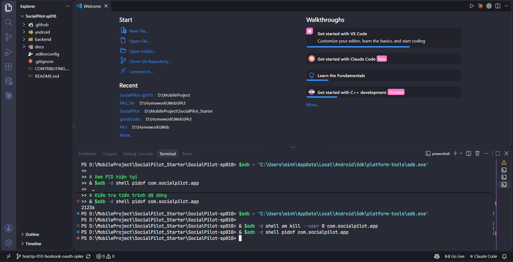

# SP-010 — callback after Android process death, 12/11/2026

## Result and provenance

**REAL PASS — owner-executed callback after process death.** Minh supplied the terminal screenshot below and reported: “đã ổn, sau đó tôi đã link và được redirect về app dù đã tắt và hiện connect page đúng”. The image proves the final process-stop/check sequence; the return to SocialPilot and correct connected Page are the owner's observation, not a phone screenshot or an independently observed UI result.

- Date recorded: 12/11/2026, Asia/Bangkok. The exact execution time was not supplied.
- Device: physical Samsung SM-G990E, Android 16 / API 36, as established in the device setup record. Device serial is omitted.
- Tested source: `2004a97076a0a81c84675508270f50348e6baa13`.
- APK SHA-256: `B9D922B52149FAD8FAB082BA0B749887FEA32FD5A1B8AA60D000BC20D258235B`.
- Android API base URL: `https://surveillance-tutorial-johnny-routing.trycloudflare.com/`.
- Backend HTTPS callback: the same origin plus `/api/oauth/facebook/callback`.
- Intended Page: Demo Page MD 24-31, ID `1427548503779474`.

## Setup and sequence

1. Before the owner test, the agent verified local/public `/api/health` returned HTTP 200 with `UP` and `CONFIGURED`. A public OAuth start request succeeded and returned the expected HTTPS redirect URI; authorization URL, state and session values were not logged in the evidence.
2. The previously installed APK contained the old `planning-theoretical-into-tmp.trycloudflare.com` base URL. It was backed up locally. The agent rebuilt source `2004a97` with the new base URL; `:app:assembleDebug` passed. `adb install -r --user 0` returned `Success`. App data was not cleared.
3. The owner began OAuth and, following the test procedure, kept the browser confirmation pending while stopping the background SocialPilot process.
4. The supplied screenshot includes an earlier attempt that still returned PID `21236`. That attempt alone is not a pass. The final sequence shows these commands, with no PID output after the second command:

   ```powershell
   & $adb -d shell am kill --user 0 com.socialpilot.app
   & $adb -d shell pidof com.socialpilot.app
   ```

5. The owner then completed Facebook confirmation and reported being redirected back into SocialPilot with the correct Page connected.

## Evidence



- Image copied unchanged from the owner's attachment; it shows no token, App Secret, authorization code or callback query string.
- Image SHA-256: `38677A888B29271D6289120687B7DED2C4DD07992A055EC680242EB0A1452DE1`.

## Limits and remaining work

- The post-callback phone UI, a post-callback PID and the exact elapsed time were not captured in the supplied image. Successful return and the connected Page rely on the owner's explicit report.
- This exercises process death while OAuth is pending, not Settings → Force stop, device reboot, API 23, or every Android lifecycle condition.
- Backend restart was not part of this first case. The subsequent [owner-executed restart case](sp-010-backend-restart-callback-2026-11-12.md) records rejection of the old callback and success of a new session while the same tunnel remained running.
- This does not test token auto-refresh, real token expiry/revocation, image/alt-text publishing, or app-side publishing. SP-010 / Issue #12 is not marked complete by this result; remaining scope disposition, review and merge conditions still apply.
