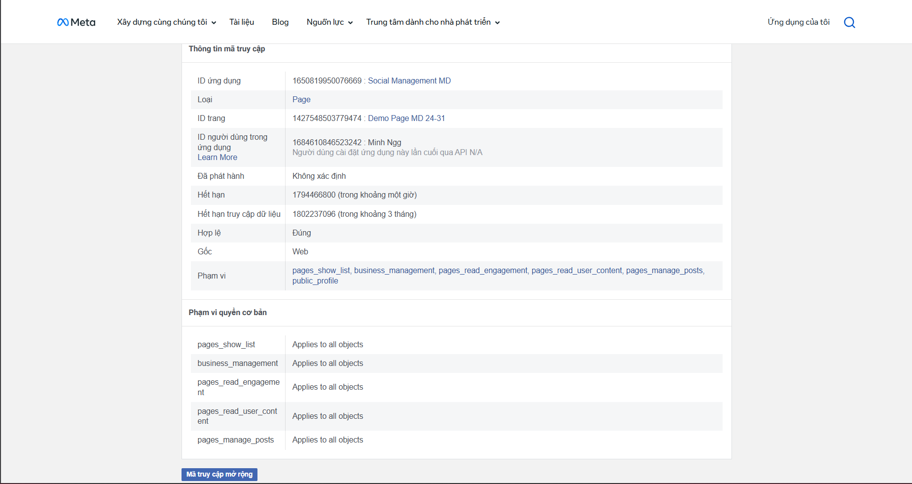
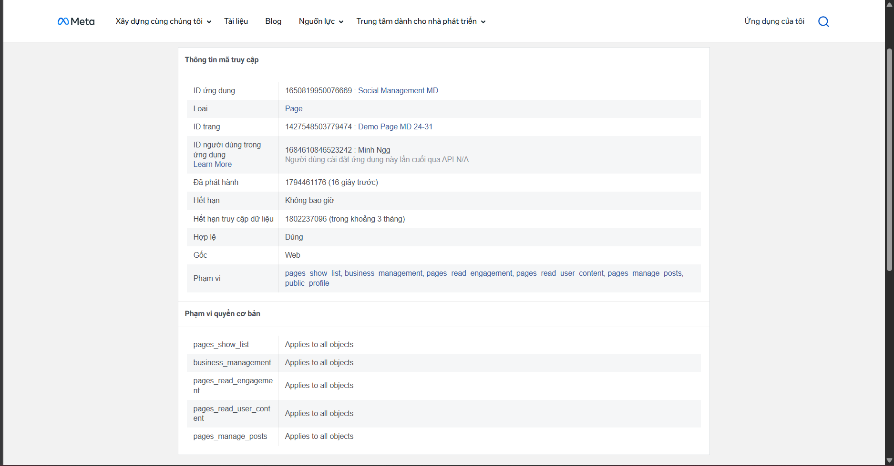
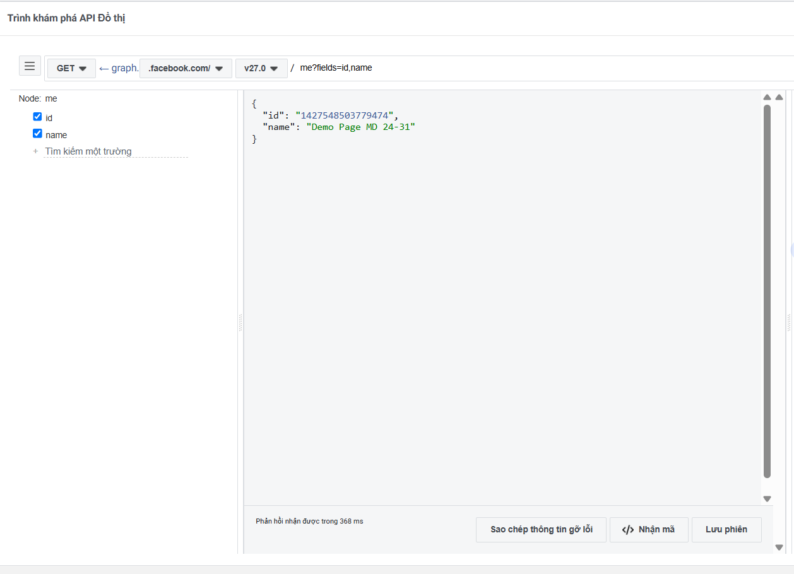

# SP-010 — Lỗi quyền thực tế và kiểm chứng Page token thủ công

- Ngày nhận bằng chứng: 12/11/2026, Asia/Bangkok.
- Người thực hiện/cung cấp: Ngô Gia Minh — TV1, owner [SP-010 / #12](https://github.com/nigPeter2503/Social_Pilot/issues/12).
- PR: [#74](https://github.com/nigPeter2503/Social_Pilot/pull/74); hồ sơ bổ sung sau head `972e87d`.
- Môi trường quan sát: Meta Access Token Debugger và Graph API Explorer, Graph API `v27.0`.
- Phạm vi: API/provider thật do owner thao tác thủ công. Agent ghi nhận ảnh/kết quả, không nhận token và không gửi request Meta trong lượt này.

## 1. Phản hồi lỗi quyền từ Meta

Owner xác nhận đã sửa dấu `/` dư trong đường dẫn và cung cấp ảnh POST có response lỗi thật trong chat. Các trường nhìn thấy:

| Trường | Kết quả |
|---|---|
| Method / endpoint | `POST /v27.0/1427548503779474/feed` |
| Page được chọn | Demo Page MD 24-31 |
| Ứng dụng được chọn | Social Management MD |
| `message` trong request | `Test Thieu Quyen Manage post 12/11/2026` |
| `error.type` | `OAuthException` |
| `error.code` | `200` — mã lỗi trong JSON của Meta; HTTP status không hiển thị trong ảnh |
| Thông báo liên quan Page | Yêu cầu `pages_read_engagement` và `pages_manage_posts`, cùng quyền quản trị phù hợp |
| Danh sách quyền đang chọn trong Explorer | `pages_show_list`, `business_management`, `pages_read_engagement`, `pages_read_user_content`; không hiển thị `pages_manage_posts` trong danh sách chọn |
| Thời gian phản hồi hiển thị | 466 ms |

**Ghi nhận:** đã có ca API thật bị Meta từ chối vì điều kiện quyền/quản trị. Không dùng vùng response trắng ở lần nhập sai URL làm evidence. Danh sách chọn của Explorer không tự chứng minh scopes của token thực tế; thông báo lỗi cũng không cô lập duy nhất một nguyên nhân giữa các quyền/API-role mà nó nêu. Không suy rằng lỗi này là token hết hạn hoặc HTTP 200 thành công.

Nguồn là ảnh response owner gửi trong chat ngày 12/11. Bản PNG cục bộ tương ứng còn hiển thị một phần credential, nên không được đưa vào Git; phần trên chỉ chép các trường request/error an toàn từ ảnh. Không tạo lại hoặc chỉnh ảnh để giả lập response.

## 2. Metadata Page token trước/sau bước mở rộng

Owner cung cấp chuỗi ảnh trước/sau theo hướng dẫn thao tác “Mã truy cập mở rộng”, cùng GET kiểm tra định danh. Các ảnh chứng minh trạng thái và kết quả quan sát được; không có log server trao đổi token hoặc bản ghi token thô.

| Trường | Trước | Sau |
|---|---|---|
| App | `1650819950076669` — Social Management MD | Không đổi |
| Type | Page | Page |
| Page | `1427548503779474` — Demo Page MD 24-31 | Không đổi |
| Hợp lệ | Đúng | Đúng |
| Đã phát hành | Không xác định | `1794461176` = 12/11/2026 12:26:16 +07:00 |
| Hết hạn token | `1794466800` = 12/11/2026 14:00:00 +07:00; ảnh ghi khoảng một giờ | “Không bao giờ” theo nhãn Debugger |
| Hết hạn truy cập dữ liệu | `1802237096` = 10/02/2027 12:24:56 +07:00 | Cùng giá trị `1802237096` |
| Gốc | Web | Web |
| Scopes hiển thị | `pages_show_list`, `business_management`, `pages_read_engagement`, `pages_read_user_content`, `pages_manage_posts`, `public_profile` | Cùng danh sách |

Ảnh trước:



Ảnh sau:



**Kết luận trong phạm vi:** ghi nhận kiểm chứng thủ công việc mở rộng/đổi token qua công cụ Meta: Page token sau được Debugger báo hợp lệ, không có ngày hết hạn token theo nhãn hiển thị. Hạn truy cập dữ liệu vẫn là trường riêng và vẫn có giá trị. Không diễn giải nhãn “Không bao giờ” thành không thể bị vô hiệu, không cần kiểm tra lại quyền, hoặc đã thử hết hạn/thu hồi thực tế.

## 3. Kiểm tra API đọc sau thao tác

Ảnh thứ ba cho thấy `GET /v27.0/me?fields=id,name` trả:

```json
{
  "id": "1427548503779474",
  "name": "Demo Page MD 24-31"
}
```

Explorer hiển thị phản hồi trong 368 ms. GET xác nhận token owner dùng ở bước kiểm tra nhận đúng Page; ảnh đã cắt ô token nên không dùng nó để so sánh giá trị token trước/sau.



## 4. Nguồn ảnh và phạm vi nghiệm thu

Ba ảnh dưới được sao chép nguyên bản từ tệp người dùng đính kèm; không chứa giá trị access token trong vùng ảnh đã kiểm tra:

| Tệp | SHA-256 |
|---|---|
| `sp-010-page-token-before-extension-2026-11-12.png` | `AC37E5A947325FF07F65D25DDA0A2E9D09689331C17B865CC606AD82E9A2B368` |
| `sp-010-page-token-after-extension-2026-11-12.png` | `6956A5502C9E45A59DF16293A5D3CB23EFE9163B5D9A9175B5DC2F108A094908` |
| `sp-010-page-identity-after-extension-2026-11-12.png` | `174EC59FF82AAB79A7D079D95746D65CBF65671DF20DAFD574A4436D10CC51E8` |

Các bằng chứng này bổ sung hai mục reviewer Thiện nêu: ca lỗi quyền thực tế và metadata/hành vi mở rộng Page token. Kết hợp [duyệt bài trước khi gửi](sp-010-publish-approval-2026-11-12.md), hồ sơ có thể được reviewer đánh giá lại trên head mới.

Chưa kiểm chứng: SocialPilot tự refresh/đổi token, token thật hết hạn/thu hồi và hành vi ứng dụng tương ứng, callback cold start/backend restart, API 23, ảnh/alt text. Kho Keystore đã có [test riêng trên API 36](sp-010-keystore-device-check-2026-11-12.txt), không thay các ca trên. Chưa đóng toàn bộ F1.B3 hoặc tự đánh dấu SP-010 Hoàn tất; còn chốt các mục taskbrief đang mở, hai human approvals, merge và cập nhật Project theo CONTRIBUTING.
