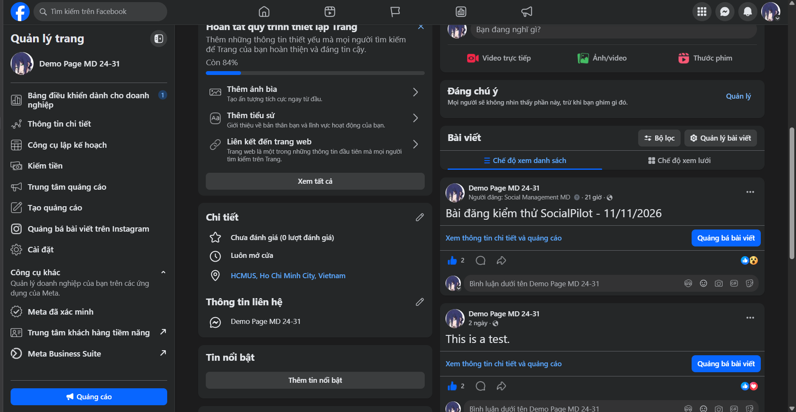

# SP-010 — Xác nhận duyệt bài thử và ảnh đối chiếu trên Facebook Page

- Task: [SP-010 / Issue #12](https://github.com/nigPeter2503/Social_Pilot/issues/12).
- PR: [#74](https://github.com/nigPeter2503/Social_Pilot/pull/74).
- Người xác nhận/người trực tiếp thử: Ngô Gia Minh — TV1, owner SP-010.
- Ngày ghi nhận bổ sung: 12/11/2026, Asia/Bangkok.
- Phạm vi: bài chữ thử bằng Graph API Explorer; không phải publish qua ứng dụng/hàng đợi SocialPilot.

## 1. Xác nhận lịch sử việc duyệt trước khi gửi

Ngày 12/11/2026, người thực hiện xác nhận trong chat làm việc:

> Khi đăng bằng Graph API explorer, tôi xem nội dung, gắn vào method post, kiểm tra đúng page, rồi chủ động gửi API, API post thẳng bài viết lên facebook.

Ghi nhận theo lời xác nhận này: Minh đã tự xem và đồng ý nội dung bài thử, chuẩn bị request POST, kiểm tra đúng Page đích rồi chủ động gửi request. Đây là thao tác duyệt thủ công của chính người dùng thực hiện phép thử trước khi gửi API. Không yêu cầu hoặc ghi nhận thêm một người khác duyệt bài; approval của PR là việc riêng.

**Nguồn chứng cứ:** xác nhận bổ sung của người trực tiếp thực hiện, được ghi sau phép thử. Chưa có ảnh/video/log ghi riêng khoảnh khắc duyệt trước khi gửi; không tự đặt một giờ duyệt chính xác hoặc coi ảnh bài đã đăng là bằng chứng trực tiếp cho thời điểm duyệt. Ngày 12/11 là ngày ghi nhận bổ sung, không phải ngày đăng bài.

## 2. Bài thử được đối chiếu

| Trường | Ghi nhận | Nguồn |
|---|---|---|
| Page | Demo Page MD 24-31 | Tên Page hiển thị trong ảnh người dùng cung cấp |
| Nội dung bài | Bài đăng kiểm thử SocialPilot - 11/11/2026 | Ảnh người dùng cung cấp và bản ghi API trước đó |
| Người đăng hiển thị | Social Management MD | Dòng “Người đăng” trong ảnh; chỉ ghi nhận nhãn hiển thị |
| Page ID | `1427548503779474` | Bản ghi Graph API Explorer trước đó; ảnh không hiển thị ID |
| Post ID | `1427548503779474_122109132231532657` | Bản ghi POST/GET trước đó; ảnh không hiển thị ID |
| Permalink | [Bài thử trên Facebook](https://www.facebook.com/122109132717532657/posts/122109132231532657) | Kết quả GET đã ghi nhận trước đó và xác nhận owner mở đúng bài; ảnh không hiển thị URL |
| Thời điểm tạo bài | `2026-11-11T06:58:10+0000`, tương đương 11/11/2026 13:58:10 +07:00 | Trường `created_time` trong bản ghi API trước đó |
| Thời điểm duyệt | Trước khi chủ động gửi request, theo xác nhận của người thực hiện; không có giờ chính xác | Xác nhận lịch sử ở mục 1 |
| Thời điểm chụp ảnh | Chưa được cung cấp; nhận ảnh trong chat ngày 12/11/2026 | Không suy thời điểm chụp tuyệt đối từ nhãn tương đối “21 giờ” |
| Phạm vi xem/lịch xóa | Chưa có xác nhận riêng về lựa chọn trước khi gửi hoặc lịch xóa | Không tự bổ sung quyết định người dùng chưa xác nhận |

Bản ghi POST/GET và xác nhận mở permalink được lưu trong [hồ sơ gốc, cập nhật owner ngày 11/11](../drafts/sp-010-facebook-oauth-draft.md#owner-evidence-and-implementation-update--11112026). Không gửi lại POST hoặc tạo bài mới trong lượt bổ sung hồ sơ này.

## 3. Ảnh đối chiếu do người dùng cung cấp

- Tệp được sao chép nguyên bản từ ảnh đính kèm người dùng; không tạo lại, chỉnh sửa hay cắt ảnh.
- SHA-256: `E5A962673CC0B7CE99AD6C3DB4CC51AD49403CFBC52B2687346F83C380E79C40`.
- Ảnh cho thấy tên Page, nội dung bài thử và dòng “Người đăng: Social Management MD”. Đây là evidence bổ sung cho kết quả bài đã xuất hiện trên Page.
- Không thấy access token, client secret, authorization code, handoff code hoặc verifier trong ảnh đã kiểm tra.

## 4. Kết luận trong phạm vi và phần còn thiếu

- **Đã ghi nhận:** xác nhận lịch sử việc người thực hiện tự duyệt nội dung/kiểm tra Page trước khi chủ động gửi POST; ảnh đối chiếu bài trên Page, kết hợp với ID/permalink/created_time đã có.
- **Chưa được chứng minh bởi ảnh này:** thời điểm duyệt trước khi gửi, request/response POST, ID/URL của bài, đầy đủ scope/API permission, ca thiếu quyền, token type/expiry/refresh, browser callback hay publish từ ứng dụng.
- Ca thiếu quyền thực tế và metadata/vòng đời Page token vẫn chưa có bằng chứng bổ sung trong lượt này; không tự chuyển thành PASS hoặc BLOCKED. Owner tiếp tục theo dõi tại Issue #12, không cần thu thập hay ghi giá trị token vào tài liệu.
- Tài liệu này bổ sung một phần feedback của Thiện trên head `cd03134`; không tự đóng Issue #12, thay approval của reviewer hoặc nghiệm thu toàn bộ F1/F5.
